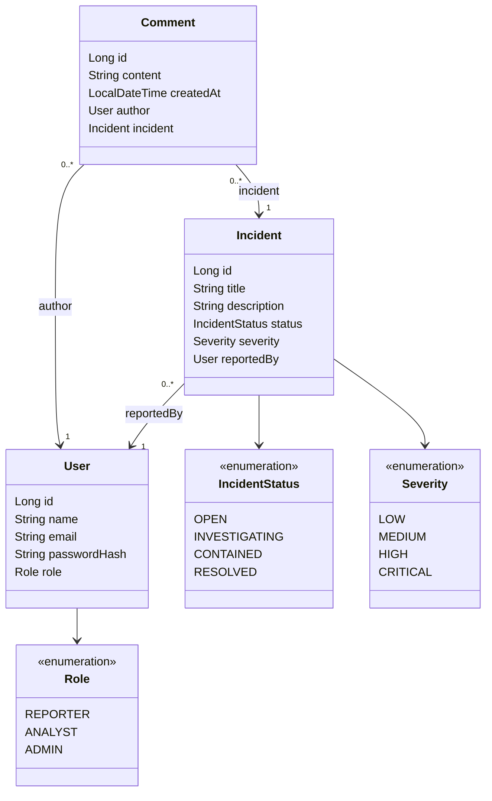

# Cyber Incident Tracker – datamodel

Diagrammet viser de entities og felter, der er implementeret i projektet.
Getters, setters og konstruktører er udeladt. Enums er faste værdisæt,
ikke selvstændige entities eller tabeller.

## Entity-diagram

## Entities og relationer

| Entity | Tabel | Formål |
| --- | --- | --- |
| User | users | Gemmer navn, unik e-mail, password-hash og én rolle |
| Incident | incidents | Gemmer hændelsens titel, beskrivelse, status, severity og rapportør |
| Comment | comments | Gemmer kommentarindhold, oprettelsestidspunkt, forfatter og hændelse |

- Hver hændelse har én rapportør. En bruger kan rapportere nul eller mange hændelser.
- Hver kommentar tilhører én hændelse og har én forfatter. En hændelse og en bruger kan hver have nul eller mange kommentarer.
- Relationerne er ensrettede `ManyToOne`-relationer. User indeholder ikke lister over hændelser eller kommentarer.
- Comment findes i entity- og DAO-laget, men har endnu ikke REST-endpoints.
- Incident har ikke `assignedTo`, `createdAt` eller `updatedAt`. Comment har `createdAt`, som sættes ved første lagring.

## Standardværdier og login

- En ny Incident starter med status `OPEN` og severity `MEDIUM`. Ved oprettelse gennem API'et skal severity sendes med.
- Status, severity og rolle gemmes som tekst med `EnumType.STRING`.
- Nye brugere får rollen `REPORTER`.
- Passwords hashes med bcrypt. `passwordHash` udelades fra JSON og `toString()`.
- Login og JWT-adgangskontrol er implementeret. Eksisterende brugere uden password-hash kan ikke logge ind.

## Nuværende rettigheder

| Rolle | Rettigheder på incident-endpoints |
| --- | --- |
| REPORTER | Hente, oprette og opdatere hændelser |
| ANALYST | Hente, oprette og opdatere hændelser |
| ADMIN | Hente, oprette, opdatere og slette hændelser |

Alle incident-endpoints kræver et gyldigt JWT. Adgangen er ikke begrænset
til brugerens egne hændelser. Roller administreres manuelt i databasen;
der er ikke et endpoint til rolleændringer.

[Tilbage til README](../README.md)
